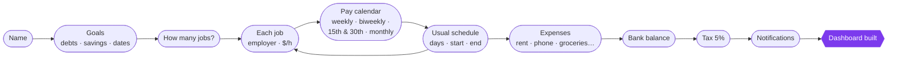
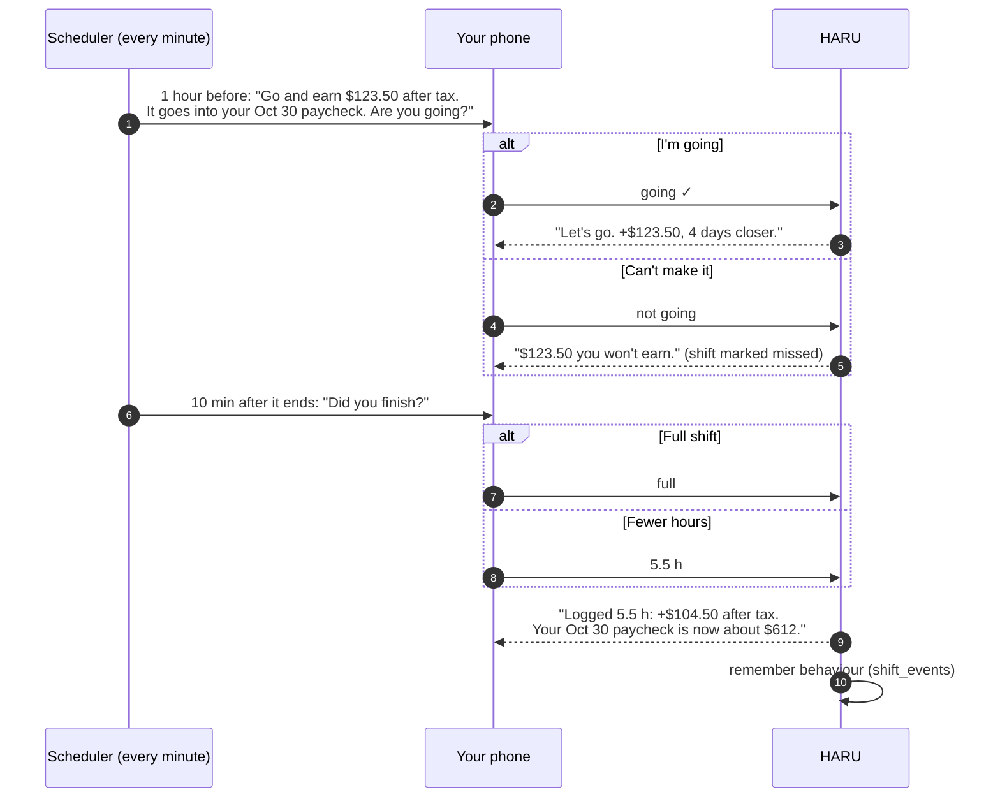
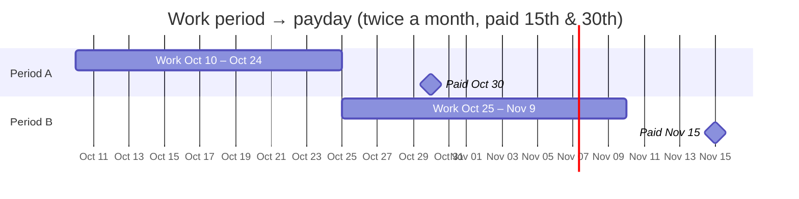
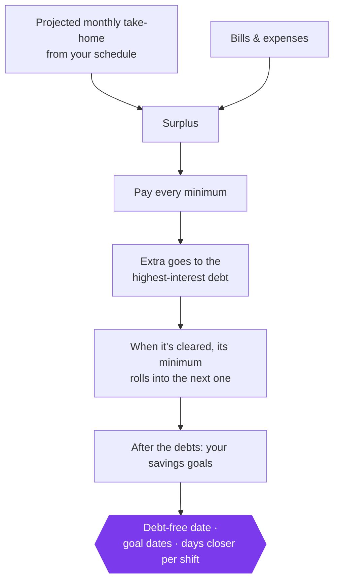
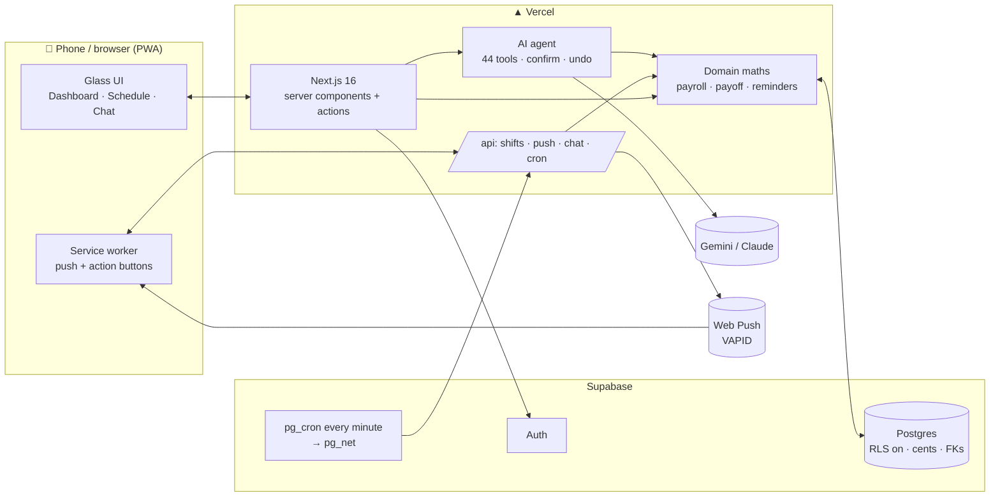
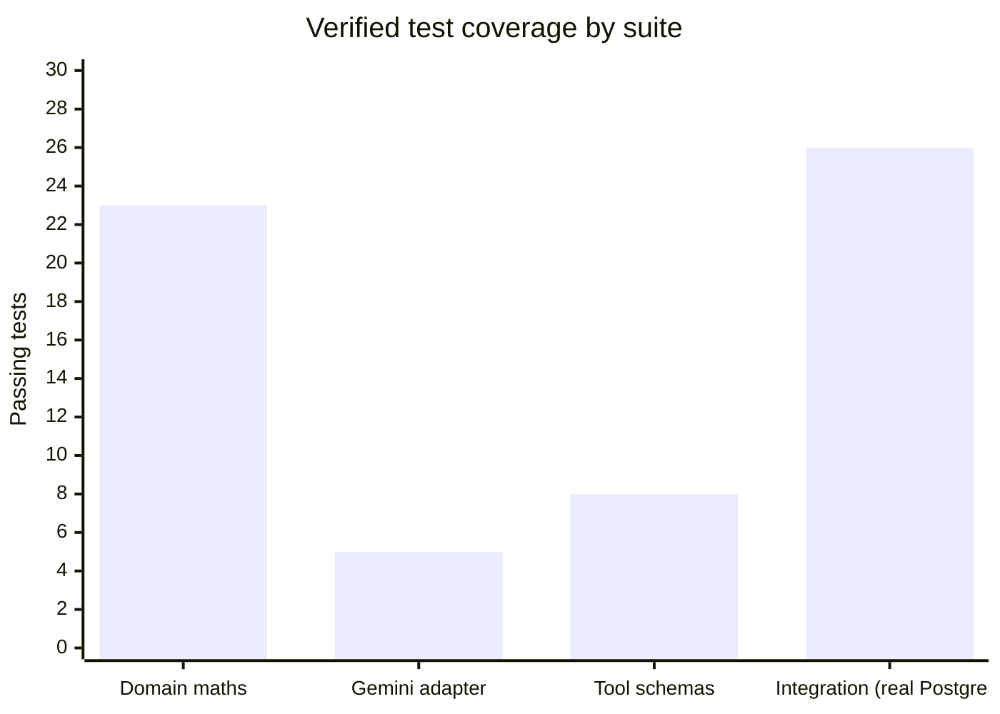

<div align="center">

# $ HARU

### Work for Haru.

**An AI money coach that thinks in shifts, not salaries.**

`Next.js 16` · `React 19` · `Supabase Postgres` · `Gemini / Claude` · `Web Push` · `PWA`

</div>

---

## What we built

HARU is a personal work-and-money app for people who are paid by the hour, often at more than one job. You never type "I make $X a month". You tell HARU your **jobs, pay rates, schedules and pay calendars**, and it works out everything else:

- what every single shift is worth **after tax**
- which **paycheck** that money lands in, and how big that paycheck is so far
- how many **days sooner** each shift gets you to your goal
- what to pay off first, and **when you'll be debt-free**

Then it stays with you. An hour before every shift it asks *"Are you going?"* and shows what you'll earn. After the shift it asks *"Did you finish?"* and logs every penny.

## Why

People who live shift-to-shift don't have a monthly income. They have a schedule that changes, two or three employers with different pay days, overtime one week and a cancelled shift the next. Budget apps built around a salary don't fit, so they get abandoned.

Skipping a shift feels free in the moment. HARU makes the cost visible: **"$123.50 you won't earn. Your debt-free date moves 4 days later."** Going feels like progress: **"Let's go. This shift is +$123.50 and puts you 4 days closer."**

The goal is motivation backed by real arithmetic, never guesses.

## Who it's for

| | |
|---|---|
| 👷 **Hourly workers** | Security, retail, food service, warehouse, care work |
| 🔀 **Multi-job people** | Two or three jobs, each with its own pay rate and pay calendar |
| 🎯 **People with a target** | A credit card to clear, a loan to repay, an emergency fund to build, all by a date |
| 📱 **Phone-first users** | Installed as an app on the home screen, with notifications that have buttons |

## How it works

### 1. The interview (no forms)

HARU asks one question at a time, like a conversation:



It never asks for monthly income. Income is calculated as **jobs × rates × schedule**.

### 2. The shift loop



The notification buttons work **without opening the app**: the service worker posts the answer and shows the result.

### 3. Paycheck maths: your real calendar

Pay periods and pay days are set per job. Example: periods **10th–24th** and **25th–9th**, paid on the **15th** and **30th**:



Supported: **weekly**, **every 2 weeks** (anchored to your next payday and the gap after the period ends), **twice a month** (any two pay days, any two period start days; `31` means the last day of the month), and **monthly**. Weekend paydays follow the job's rule.

### 4. Take-home, every time

```
gross       = hours × rate          (minus unpaid break)
tax set-aside = gross × 5%          (configurable)
take-home   = gross − tax set-aside
```

All money is stored as **integer cents**. Nothing is rounded twice, and floating-point maths never touches a balance.

### 5. The payoff plan



`daysCloser = shift take-home ÷ (monthly surplus ÷ 30.44)`: this is the "4 days closer" number on every shift card.

### 6. An AI that does things

Ask in plain words: *"I picked up an extra shift at the restaurant Saturday 5 to 11"*, *"I didn't go today"*, *"how long until my Visa is gone?"*. The assistant has **44 typed tools** (shifts, attendance, checkout, paychecks, bills, debts, goals, payoff plan, reminders and more).

- Every tool input is validated with Zod before anything touches the database.
- Write actions return an **undo**, and risky actions ask to **confirm** first.
- It sees a live snapshot of *today's picture* (next shift, paycheck so far, streak, plan) so answers are specific and short.
- It **learns from behaviour**: every going, skip, full or partial shift is stored, and patterns such as "you've missed 3 of the last 4 Saturdays" become gentle observations.
- Works with **Google Gemini** (free tier) or **Anthropic Claude**. If the provider fails, the exact reason is shown (bad key, quota, wrong model).

## Architecture



**Reliable notifications.** The scheduler plans reminders into a table with **dedupe keys**, claims them with `FOR UPDATE SKIP LOCKED`, retries failures, and re-checks before sending, so a cancelled or skipped shift never pings you. The device confirms delivery back to the server.

## By the numbers



| Metric | Value |
|---|---|
| AI tools | **44**, all schema-validated |
| Pay calendars | weekly · biweekly · twice-monthly (custom days) · monthly |
| Money precision | integer cents end to end |
| Reminder lead | 60 min before each shift, check-in 10 min after |
| Default tax set-aside | 5%, editable |
| Notification cadence | every minute (pg_cron) |
| Data isolation | composite foreign keys per user · RLS with no public access |

## Design

White and violet **glassmorphism**: frosted panels (`backdrop-blur`) floating over soft violet light, a violet gradient hero for the next shift, gradient area charts for take-home, and a **$** mark as the logo. Sora for type. Built mobile-first and installable as an app.

## Running it

```bash
npm install
cp .env.example .env.local     # Supabase URL/keys, DATABASE_URL, GEMINI_API_KEY, VAPID keys
npm run db:migrate             # applies 0001_init + 0002_shift_loop
npm run dev
```

Tests: `npm test` (domain, Gemini, tool schemas) · `npm run test:integration` against a throwaway database.

---

<div align="center"><b>$ HARU</b> · Work for Haru.</div>
