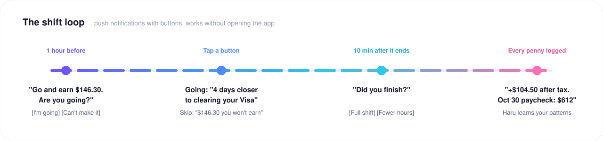
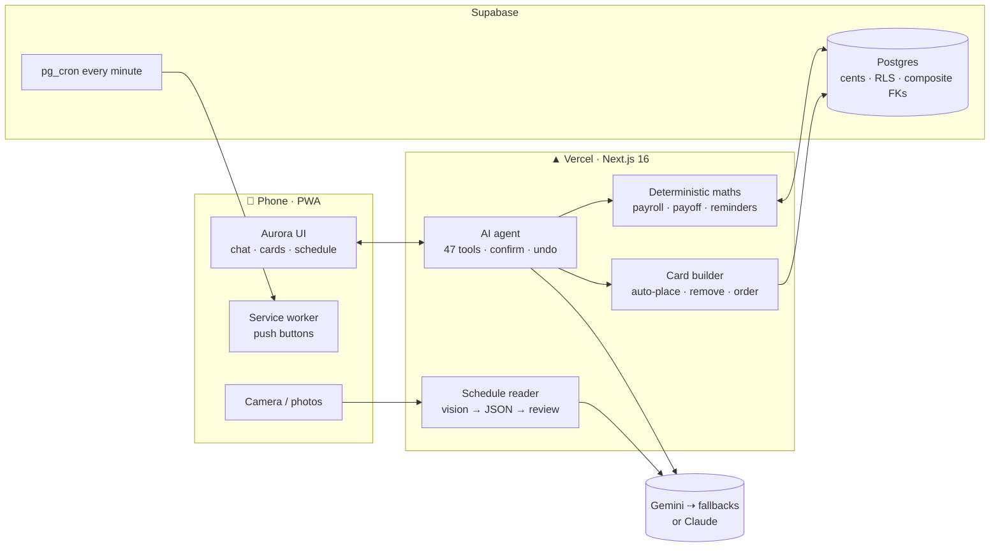

<div align="center">


<br />


<br />


<h3>Work for Haru.</h3>

An AI money coach for people paid by the hour. You talk to Haru, and it builds your money dashboard.

[What it is](#what-it-is) · [Who it's for](#who-its-for) · [How it works](#how-it-works) · [Under the hood](#under-the-hood) · [Run it](#run-it)

</div>

---

## What it is

Most budget apps start with *"What's your monthly income?"* People who work shifts can't answer that. Their income is a schedule that changes every week, at two or three jobs, each with its own rate and its own payday.

Haru never asks for monthly income. It asks about your **jobs, pay rates, pay calendar and schedule**, and works the money out from those:

| You tell Haru | Haru shows you |
|---|---|
| "BioARO, $22 an hour, paid the 15th and 30th" | Your next paycheck, with the shifts already counted toward it |
| "I work Fri–Sun, 4 to 11" *(or a photo of the roster)* | **+$146.30 after tax** on every shift, before you go |
| "I owe $2,400 on my Visa at 22.99%" | What to pay first, and the date you'll be debt-free |
| "Phone $115 on the 25th, groceries about $90 a week" | What's safe to spend until payday |

The dashboard **starts empty**. Each answer you give adds a card. Haru adds, removes and reorders cards as your life changes, and you can ask it to: *"take spending off, put the payoff plan first."*



## Who it's for

- **Hourly workers** in security, retail, cafés, warehouses and care work.
- **People with two or three jobs**, each with a different rate and payday.
- **Anyone with a target and a deadline**: a credit card to clear, a loan, an emergency fund.
- **Phone-first users.** Haru installs to the home screen and sends notifications with buttons.

## How it works

### 1. A conversation, not a form

A new person sees one thing: a living aurora orb and the question *"What should I call you?"* From there Haru interviews you one question at a time, with tap-to-answer buttons where they help:

```
goals + deadlines  →  how many jobs  →  each job's rate  →  how it pays
→  your usual schedule (or 📷 a photo of it)  →  bills: rent, phone, groceries…
→  bank balance  →  tax set-aside (5%)  →  shift reminders on  →  done
```

Every answer is saved the moment you give it, and its card appears on the dashboard.

### 2. Your schedule as a calendar, or snap it

Schedule is a month calendar. Each day shows a coloured bar per shift (one colour per job) and a coin on paydays. Tap a day to see what it earns, mark "I'm going", log different hours, delete a shift or add one, either once or every week. Shifts that cross midnight and two shifts on one day are both fine.


Take a photo of a printed roster, a whiteboard or a screenshot from your work app. Haru reads every shift (date, start, end, break, which job), resolves *"Mon / Tue"* to real dates and flags anything it had to guess. **Nothing is saved until you review it.** Every row can be edited, unticked or deleted, and you can add shifts it missed.

### 3. The shift loop



The buttons work **from the notification itself**, without opening the app. Every answer (going, skipped, finished, fewer hours) becomes behaviour memory. If you keep missing Saturdays, Haru notices and tells you what it costs.

### 4. Your real pay calendar

Pay is set per job:

| Calendar | Example | How Haru counts it |
|---|---|---|
| Every week | Paid Fridays | Period ends, paid *n* days later |
| Every 2 weeks | Next payday Oct 30, 5 days after the period | Anchored to your next payday |
| Twice a month | Work 10th–24th → paid 30th; 25th–9th → paid 15th | Custom period start days *and* pay days (31 = last day of the month) |
| Monthly | Paid the 1st | One period per month |

Weekend paydays follow the job's rule. Take-home is calculated as:

```
gross     = paid hours × hourly rate        (unpaid breaks removed)
set-aside = gross × 5%                      (your tax estimate, editable)
take-home = gross − set-aside
```

All money is stored as **integer cents**. Floating-point arithmetic never touches a balance.

### 5. The payoff plan



Haru projects your monthly take-home from your schedule, subtracts bills and minimum payments, and sends what's left to **one target at a time**: highest interest first, then your savings goals. That's where *"this shift gets you 4 days closer"* comes from:

```
days closer = shift take-home ÷ (monthly surplus ÷ 30.44)
```

### 6. An AI that acts, carefully

- **49 typed tools.** Every argument is validated with Zod before anything touches the database.
- **Read, write and confirm levels.** Risky changes (time zone, currency) wait for your tap. Writes come with **Undo**.
- **Haru never does arithmetic.** Every number comes from deterministic code. The model only decides which tool to call.
- **Haru knows your situation.** Each turn it sees a live snapshot (next shift, paycheck so far, streak, payoff focus), so replies are short and specific.
- **Haru remembers you.** Corrections ("it's the 15th and 30th, not the 3rd"), plans ("2,000 CAD home every month") and preferences are saved as short facts for that person only and shown to Haru on every turn. Nothing about any user is hardcoded.
- **Haru checks its own work.** Every saved job comes back with the computed next payday ("Next payday Fri, Oct 30, for work Oct 16 to Oct 30"), so a wrong date is caught and fixed straight away. It can't save a pay calendar it hasn't been told: a twice-a-month job without pay days is refused, and Haru asks instead.
- **Haru knows the date.** A calendar from last week to three weeks ahead, with paydays and bills marked, is in every turn, so "this Friday" and "next paycheck" are always right.
- **You see it working.** Each step streams to the chat as it happens ("Saving your job ✓", "Adding Rent ✓"), and big messages are saved in one go.
- **Busy servers don't stall you.** If Gemini is overloaded (503) or out of quota (429), Haru retries and then falls back through `gemini-3.8-flash → 3.6-flash → 2.5-flash`, re-signing tool-call history so the switch is safe. If every model is busy, nothing is stored and you get a **Retry** button.

### 7. Invest: one tab for India, Canada and the world

Pick a country, tick what you care about (stocks, ETFs, gold, silver, mutual funds, GICs, crypto, currency, real estate, land, shops), and the tab builds itself around you:

- **Real prices, labelled honestly.** Every number shows where it came from and how fresh it is: *Live*, *15 min delayed*, *Close, Oct 22* or *Official (Bank of Canada)*. Nothing is ever made up. Gold per 10 g in rupees is computed from gold in dollars × USD/INR.
- **Charts like a trading site.** 1D to Max, line or candles, drag a finger for the price on any day.
- **Numbers by code, words by AI.** Returns, 5-year CAGR, 52-week range, swings and drawdown are calculated, then Haru writes a short take that also looks at your budget and debts. It always says: *this is an AI estimate, I may be wrong, not financial advice.*
- **News that matches you.** The Economic Times, Mint, BusinessLine, Aaj Tak, CBC, Financial Post, The Globe and Mail, The New York Times, The Washington Post and BBC, tagged to countries, interests and assets, refreshed every 15 minutes.
- **It learns.** What you open, save and ask about shapes what you see first, with a three-week memory.
- **Things without a live price** (land, shops, real estate, deposits) get context, news and Haru's take instead of fake numbers.

## Under the hood





| Layer | Choices |
|---|---|
| App | Next.js 16 App Router, React 19, server actions, strict TypeScript |
| Look | Stone #F3F1F0 background with charcoal #494D4F glass and champagne accents. Unbounded for money figures, Geist for text. One animated orb is Haru's presence: it drifts when idle, swirls while thinking and breathes when it answers |
| Data | Supabase Postgres via postgres.js, row-level security on with no public access, money in cents |
| AI | Provider-neutral adapter (Gemini REST or Anthropic SDK), Zod → JSON Schema tools, vision for schedules |
| Notifications | Web Push (VAPID), durable reminder queue with dedupe keys, `FOR UPDATE SKIP LOCKED`, retries, delivery receipts |
| Safety | Every write is user-scoped and validated, every AI action is logged with undo, and text inside your records is treated as data, never as instructions |

## Run it

```bash
npm install
cp .env.example .env.local        # Supabase, DATABASE_URL, GEMINI_API_KEY, VAPID, market data keys
npm run db:migrate                # 0001 … 0006 (invest)
npm run dev
```

`npm test` runs the domain, invest, Gemini and tool-schema tests. `npm run test:integration` runs the end-to-end suite against a throwaway Postgres.

<div align="center">
<br />

<br />
<sub><b>HARU</b>: work for Haru.</sub>
</div>
