<div align="center"></div>

# HARU

**Work for Haru.** The full product story, with diagrams, is in **[HARU.md](HARU.md)**.

HARU is a personal work-and-money assistant: one AI command center and one adaptive dashboard over a single PostgreSQL database. It tracks multiple jobs with independent payroll rules, shifts, one-time work offers, paychecks, cash, bills, savings goals and debt. It sends real push notifications from the server, so reminders arrive even when the site isn't open.

Every financial number is computed by deterministic code from stored records. The AI understands requests and calls authorised, validated tools; it never does the arithmetic and never writes to the database directly.

---

## What's in the box

| Area | Where |
| --- | --- |
| Schema, constraints, views, RLS lockdown | `db/migrations/0001_init.sql` |
| Shift loop: attendance, check-out, custom pay calendars, behaviour memory | `db/migrations/0002_shift_loop.sql` |
| AI-built dashboard cards | `db/migrations/0003_ai_dashboard.sql` |
| Haru's memory of each person | `db/migrations/0004_memory.sql` |
| Confirmed paydays | `db/migrations/0005_pay_confirmed.sql` |
| Invest: profiles, watchlist, signals, market cache, news | `db/migrations/0006_invest.sql` |
| Market data (multi-provider, cached), news feeds, ranking, AI take | `src/lib/invest/*`, `src/lib/server/invest/*` |
| Database integrity tests (14) | `db/tests/integrity.sql` |
| Pure financial / payroll / time-zone logic | `src/lib/domain/*` |
| User-scoped services (jobs, shifts, payroll, money, reports, dashboard) | `src/lib/server/services/*` |
| AI provider abstraction, tools, agent loop | `src/lib/ai/*` |
| Push delivery + durable scheduler | `src/lib/server/notifications/*`, `public/sw.js` |
| UI: dashboard, invest, command center, records, settings, onboarding | `src/components/*`, `src/app/*` |
| Tests: unit (62), integration (36), against the real postgres.js driver | `tests/` |

**Stack:** Next.js 16 (App Router) · React 19 · TypeScript · Tailwind CSS 4 · Supabase (Postgres + Auth) · postgres.js with plain SQL migrations · Zod 4 · Anthropic Claude (behind `src/lib/ai/provider.ts`) · Recharts · web-push.

*Why plain SQL instead of an ORM:* the financial guarantees live in the database — composite foreign keys that make cross-user references impossible, check constraints (a shift's gross must equal minutes × rate), partial unique indexes (a paycheck can be deposited once) and views that derive balances. Those are clearest as SQL, and every one is tested.

---

## Setup (about 20 minutes)

### 1. Install

```bash
npm install
cp .env.example .env.local
```

### 2. Supabase (database + sign-in)

1. Create a project at [supabase.com](https://supabase.com) (the free plan works).
2. **Project Settings → API**: copy the project URL and the `anon` key into `NEXT_PUBLIC_SUPABASE_URL` and `NEXT_PUBLIC_SUPABASE_ANON_KEY`.
3. **Project Settings → Database → Connection string**:
   - *Transaction pooler* (port 6543) → `DATABASE_URL` (used by the app on Vercel).
   - *Session pooler* or direct (port 5432) → `DATABASE_URL_MIGRATIONS` (used only for migrations).
4. **Authentication → Providers → Email**: email + password is enabled by default. If you don't want confirmation emails, turn off **Confirm email**. (HARU itself sends no email.)
5. **Authentication → URL Configuration**: set the Site URL to your deployment URL and add `https://YOUR-DOMAIN/auth/callback` to Redirect URLs.
6. Run the migrations:

```bash
npm run db:migrate
```

The migration enables row-level security with **no policies** on every table and revokes access from Supabase's `anon`/`authenticated` roles. That means Supabase's public Data API cannot read HARU's tables at all; only HARU's server (connecting as the database owner) can, and it scopes every query to the signed-in user.

### 3. AI

Recommended: create a key at [console.anthropic.com](https://console.anthropic.com) and set `ANTHROPIC_API_KEY`. Claude answers first (default `claude-opus-5-5`, or set `HARU_CLAUDE_MODEL=claude-sonnet-5-5` to spend less). Also set the free `GEMINI_API_KEY` from [aistudio.google.com/apikey](https://aistudio.google.com/apikey) and Haru switches to Gemini automatically when Claude is busy. Either key alone works. Without a key, everything except the chat works, and the chat says plainly that the AI isn't configured.

To use another vendor later, add an adapter implementing `ChatProvider` in `src/lib/ai/` and return it from `getProvider()`.

### 4. Push notifications (VAPID)

```bash
npm run vapid
```

Copy the three printed lines into your env. The private key is server-only. Never prefix it with `NEXT_PUBLIC_`.

### 5. Scheduler secret

```bash
node -e "console.log(require('crypto').randomBytes(32).toString('hex'))"
```

Set it as `CRON_SECRET`.

### 6. Run locally

```bash
npm run dev
```

Open http://localhost:3000, create an account, and follow the short setup.

---

## Deploying to Vercel

1. Push this folder to a GitHub repository and import it in Vercel.
2. Add every variable from `.env.example` under **Project → Settings → Environment Variables** (Production and Preview).
3. Deploy. Then set `NEXT_PUBLIC_APP_URL` to the production URL and update the Supabase redirect URLs (step 2.5).

### The reminder scheduler — read this

Reminders are stored in the database and delivered by `GET/POST /api/cron/notifications`, which must be called **about once a minute** with `Authorization: Bearer <CRON_SECRET>`. The browser plays no part in scheduling.

Vercel's own cron limits (checked against Vercel's docs, July 2026): **Hobby** plans may run a cron only **once per day**, with ±59-minute precision, and a more frequent schedule fails the deploy. **Pro** allows once per minute. So:

- **Recommended (any Vercel plan, free): Supabase `pg_cron`.** Open Supabase → SQL Editor, paste `db/supabase-scheduler.sql`, replace the two placeholders (your `CRON_SECRET` and domain), and run it. Supabase then calls HARU every minute. The file includes queries to check it's running.
- **Vercel Pro:** change the schedule in `vercel.json` to `"* * * * *"`. Vercel sends the bearer secret automatically.
- **Any other HTTP scheduler** (e.g. cron-job.org) works the same way: POST every minute with the header.

The shipped `vercel.json` runs once a day, which is valid on every plan and acts only as a safety net; it is not frequent enough for shift reminders on its own.

**Why it's safe to call repeatedly:** each run (1) plans automatic reminders for the next 36 hours with deterministic keys (`unique(user_id, dedupe_key)`), (2) claims due reminders atomically with `FOR UPDATE SKIP LOCKED`, (3) re-checks each is still relevant (shift still scheduled, bill still unpaid…), (4) sends to every subscribed device and logs each attempt, then marks it sent, retries with backoff on push-service errors (up to 4 attempts), or fails. Expired subscriptions (HTTP 404/410) are removed. Reminders more than 2 h late (12 h for ones you asked for) expire instead of arriving uselessly. Notifications use the reminder id as their tag, so a device never stacks duplicates.

### Turning on notifications (for you, the user)

1. Open HARU → **Settings** (gear icon) → **Turn on notifications**. The browser asks for permission only at this moment.
2. Press **Send a test**. HARU shows three separate steps: device subscribed → accepted by the browser's push service → **shown on this device** (the service worker confirms display).
3. **iPhone/iPad:** Safari only allows web push for apps on the Home Screen. Tap Share → *Add to Home Screen*, open HARU from the icon, then turn notifications on.
4. If permission was denied, allow it in the browser's site settings (the icon left of the address bar) and reload.

Reminder categories and timing (minutes before shifts, the time to nudge you to log hours, days before bills) are in the same Settings panel.

---

## Environment variables

| Variable | Required | Notes |
| --- | --- | --- |
| `DATABASE_URL` | yes | Supabase transaction pooler (6543). Server only. |
| `DATABASE_URL_MIGRATIONS` | for migrations | Session pooler / direct (5432). Falls back to `DATABASE_URL`. |
| `NEXT_PUBLIC_SUPABASE_URL` | yes | Public. |
| `NEXT_PUBLIC_SUPABASE_ANON_KEY` | yes | Public by design; it cannot read HARU's tables (see RLS above). |
| `ANTHROPIC_API_KEY` | for the AI (recommended) | Claude answers first when set. Server only. |
| `HARU_CLAUDE_MODEL` | no | Default `claude-opus-5-5`; `claude-sonnet-5-5` is cheaper. |
| `GEMINI_API_KEY` | for the AI (free) | Used alone, or as the automatic backup when Claude is busy. Server only. |
| `HARU_GEMINI_MODEL` | no | Default `gemini-3.8-flash`. |
| `HARU_AI_FALLBACK_MODELS` | optional | Comma-separated Gemini models tried when the main one is busy. Default: `gemini-3.6-flash,gemini-2.5-flash` (flash-lite is left out: it drops details). Empty string disables fallback. |
| `TWELVE_DATA_API_KEY` | for Invest (free) | US stocks/ETFs, FX, crypto, gold/silver, live. Server only. |
| `ALPHA_VANTAGE_API_KEY` | for Invest (free) | BSE (India) and TSX (Canada) end-of-day history. Server only. |
| `EODHD_API_KEY` | optional (paid) | Delayed NSE/TSX quotes and Nifty/Sensex/TSX indexes. Server only. |
| `NYT_API_KEY` | optional | NYT Top Stories API on top of the RSS feeds. Server only. |
| `NEXT_PUBLIC_VAPID_PUBLIC_KEY` | for push | Public. |
| `VAPID_PRIVATE_KEY` | for push | Server only. |
| `VAPID_SUBJECT` | for push | `mailto:` or `https:` contact. |
| `CRON_SECRET` | for reminders | ≥ 16 chars; protects the scheduler endpoint. |
| `NEXT_PUBLIC_APP_URL` | recommended | Your deployed URL. |
| `SUPABASE_SERVICE_ROLE_KEY` | optional | Lets "Delete my account" also delete the login identity. Server only. |
| `DB_POOL_MAX` | optional | Connections per server instance (default 5). |

---

## How the money model works

Six states are kept separate everywhere — database, dashboard, reports and AI answers:

1. **Work completed** (a shift, with the wage used stored on the shift)
2. **Earned** (gross = paid minutes × that wage; checked by a DB constraint)
3. **Pay period** (computed per job from its own rules: weekly / biweekly from an anchor date, semimonthly with a split day, monthly; payday offset; weekend rule)
4. **Paycheck expected** (forecast from logged + scheduled shifts; deductions shown only if you supplied them)
5. **Paycheck received** (you tell HARU what arrived; it compares with logged hours and shows the difference)
6. **Cash deposited** (one `paycheck` transaction per pay period, enforced by a unique index; the period's shifts are linked so they stop counting as unpaid)

Other rules: logging work never changes cash. Transfers between your accounts are neither income nor spending. Debt payments lower cash and debt, and are reported separately from spending. Goal contributions *earmark* cash; they don't move or spend it. The **reserve estimate** (default 5%) is a planning cushion, never presented as tax. Balances are labelled as manually tracked; there is no bank connection. **Safe to use** = cash − bills due before your next payday − money set aside for goals.

Corrections keep history: transactions are voided, not deleted; every change goes to `activity_log`; changing a wage adds to wage history without rewriting past shifts.

## How the AI is constrained

- ~40 tools (`src/lib/ai/tools.ts`), each with a Zod schema. The model receives JSON Schema generated from that same schema, and every call is re-validated on the server before running.
- Tools call the same user-scoped services the forms use. The model has no SQL access and no code execution.
- **Read** tools run freely. **Write** tools run and are recorded with an undo plan. **Confirm** tools (deleting records, changing pay rules or wages, setting a balance, voiding a transaction, batches over 3, changing currency/time zone) only create a pending action with a plain-language preview; nothing happens until you press **Confirm**. Confirm is single-use.
- Undo works for 7 days and refuses when later records depend on the change (e.g. a job that now has shifts).
- The system prompt carries today's date, a 3-week calendar, your time zone and your record ids, so "this Saturday" and "my security job" resolve without guessing.
- If the AI service fails mid-request, the reply says so and lists exactly which steps had already been saved.
- Rate limit: 10 messages/minute, 120/hour per user.

## Personalisation

HARU records structured events (`activity_log`) and derives evidence-based observations (`src/lib/domain/observations.ts`): your usual hour for logging shifts, the hourly rate below which you decline offers, and whether you save after payday. Nothing is inferred from a single event; small samples are labelled "early pattern". Each observation shows its basis and can be dismissed, and a dismissed one never comes back. The model is not retrained; these are stored facts.

## Adaptive dashboard

Components come from a fixed registry (`src/lib/dashboard-registry.ts`). Their order is computed from your data: anything urgent first, then your money, then a payday within 2 days or a bill within 2 days rise above the rest; empty components are hidden. You (or the AI) can reorder, show or hide registered components; the AI can't create UI. Layout changes are undoable, and "Let HARU arrange it again" resets.

---

## Testing

```bash
npm test                    # 27 unit tests: money, DST, payroll, forecasts, reports, reminders, AI tool schemas
npm run typecheck
npm run test:db             # needs TEST_DATABASE_ADMIN_URL; creates and drops a throwaway database
HARU_TEST_DATABASE_URL=postgres://… npm run test:integration   # 23 end-to-end tests on a migrated DB
```

Never point the database tests at production.

The integration suite covers the brief's acceptance tests A–J against a real database: shift logging, one-time work, per-job paydays, expenses, reports, push delivery exactly once (including expired-subscription cleanup and retry/backoff), persistence, double-count prevention, user isolation (including through the AI tools), and honest failure handling. It drives the AI agent with a scripted stand-in for the model, so it needs no API key.

## Data export and deletion

Settings → **Your data**: export everything as JSON, download a CSV report, or delete the account. Deletion removes every row (all tables cascade from the user) and signs you out; with `SUPABASE_SERVICE_ROLE_KEY` set it also deletes the login identity.

## Known limitations

- **No bank sync.** Balances are what you record, and are labelled that way.
- **Payroll is rule-based, not your employer's system.** Overtime, holiday pay and statutory deductions aren't assumed. Enter known deductions on a job to see an estimated net.
- **Web push** needs a supporting browser; on iOS it needs the Home Screen app. When push is unavailable, reminders still appear in HARU's notification inbox and are marked as not pushed.
- **Single currency per user.** Jobs record a currency, but totals assume the user's currency.
